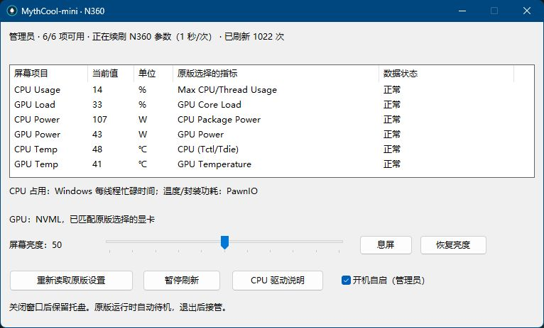

<p align="center"></p>
<h1 align="center">MythCool-mini</h1>
<p align="center">保留冷头视频，让参数轻量续刷。</p>
<p align="center">Windows x64 · C++20 / Win32 · MPL-2.0 · 便携应用</p>
<p align="center"><a href="https://github.com/Axiomerator/MythCool-mini/actions/workflows/windows.yml"></a></p>
<p align="center"><a href="https://github.com/Axiomerator/MythCool-mini/releases/latest">下载发行版</a> · <a href="docs/SUPPORT.md">支持范围</a> · <a href="docs/RESOURCES.md">资源实测</a> · <a href="docs/DEVELOPMENT.md">构建与开发</a></p>

面向 **VK N360 冷头屏幕**的轻量 Windows 托盘程序。沿用原版 Myth.Cool 设置的视频和监控布局，在原版退出后继续刷新参数，并提供亮度与登录自启开关。

**视频导入、转码上传和布局编辑仍由官方 Myth.Cool 完成。mini 负责现有配置的常驻续刷，使用时应保留原版及其用户配置。**

<p align="center"></p>

## 功能

- 自动读取原版配置，保留最多六槽的标题、位置、对齐、颜色及单位，只采集启用的指标。
- 每秒续刷；原版运行时让出设备，原版退出后重新读取布局。
- 原生状态页与托盘菜单，亮度 0～100，可息屏、恢复本次运行中记录的非零亮度。
- 默认申请管理员权限；当前用户登录后可通过最高权限计划任务进入托盘。
- EXE、采集 DLL 与签名模块合计约 **0.87MiB**；程序侧无需 .NET、WebView、Electron 或视频解码运行时。

## 下载与使用

1. 在 [Releases](https://github.com/Axiomerator/MythCool-mini/releases) 下载 **MythCool-mini-版本-windows-x64.zip**，解压到固定、可写目录。
2. 按需安装 [PawnIO 官方签名驱动](https://pawnio.eu/)。CPU 温度和功耗依赖此驱动及管理员权限，mini 不会自动安装。
3. 用原版设置视频和监控布局，然后**从原版托盘退出**。
4. 双击 `MythCool-mini.exe`，按 UAC 提示启动。默认驻留托盘；双击托盘图标打开状态页。
5. 如需自启，勾选“开机自启（管理员）”；当前用户登录约 10 秒后进入托盘。

窗口 X 会收起到托盘，完全退出使用托盘菜单。更换视频或布局时重新打开原版，编辑完退出；mini 自动接管，也可点“重新读取原版设置”。

缓存位于 EXE 旁的 `data/`。升级时退出 mini、替换程序并保留该目录。移动目录后重新开启自启以更新任务目标。应用文件可便携放置；PawnIO 由 Windows 安装到系统目录。[自启说明](docs/AUTOSTART.md)

> GitHub 自动生成的 Source code ZIP 是源码。直接运行请选择带 **windows-x64** 的应用发行包。

## 支持范围

| 项目 | 当前状态 |
| --- | --- |
| 冷头屏幕 | **VK N360**，USB `374A:A017`，实机验证 |
| CPU 温度 / 功耗 | 限 AMD Family `1Ah` / Model `44h`；**Ryzen 9 9950X** 实测 |
| GPU 三项 | NVIDIA NVML；**RTX 3080 Ti** 实测，需唯一匹配原版选择的显卡 |
| 操作系统 | **Windows 11 x64** 实测；Windows 10、ARM64 未实测 |
| 原版配置 | Myth.Cool 业务版本 **1.1.22.420** 实测 |

当前识别的原版指标：

| 原版名称 | 含义 / 来源 |
| --- | --- |
| Max CPU/Thread Usage | 最忙逻辑处理器的忙碌比例，**不是全 CPU 平均占用** |
| Total CPU Usage / Total CPU Utility | 系统总忙碌比例 / Windows 性能计数器 |
| CPU Package Power | AMD 封装能量计数器差分，W |
| CPU (Tctl/Tdie) | AMD SMN 温度 |
| GPU Core Load / GPU Power / GPU Temperature | NVIDIA 驱动 NVML 读数 |

其他冷头、其他 CPU 温度/功耗后端、AMD/Intel GPU、多冷头及多显卡组合未验证或未实现。未支持或不可读的指标显示 `--`；表外参数需要新增采集实现。采样口径可能与原版存在差异。mini 聚焦冷头屏幕，不接管水泵和风扇控制。[完整限制](docs/SUPPORT.md)

## 资源占用

9950X / RTX 3080 Ti，同机完整六项配置：

| 指标 | 原版历史记录，5 秒 | mini v0.2.0，本次 60 秒 |
| --- | ---: | ---: |
| 私有提交 | 422.8MiB | 28.7MiB |
| 工作集，应用进程求和 | 275.2MiB | 48.3MiB |
| 整机 CPU，按 32 逻辑处理器归一化 | 1.10% | 0.0317% |

mini 本次私有工作集约 **26.0MiB**。对照记录，私有提交低约 **93.2%**，CPU 样本值低约 **97.1%**。这是不同时段的历史对照，原版样本较短，**不属于严格同期 A/B 基准**；多进程工作集的共享页也可能重复计入。完整功能版本仍高于约 10MB 的目标，NVML 是主要内存来源。[测量方法和数据](docs/RESOURCES.md)

已验证注销后重新登录、自启及冷头正常显示，也验证了六项续刷和亮度息屏/恢复。睡眠/唤醒、长时间运行及更多硬件组合仍需实测。

## 从源码构建

需要 Visual Studio 2022 C++ 桌面工具、Windows SDK、CMake ≥3.25、Git 和 PowerShell：

```powershell
.\tools\bootstrap.ps1
.\tools\build.ps1
```

输出到 `build/Release/`。独立构建、测试并生成发行包：

```powershell
.\tools\package.ps1
```

发行文件位于 `releases/`，不覆盖运行中的 `dist/` 或个人数据。只有重建图标、测量资源时需要 Python 标准库。依赖固定于 `dependencies.lock.json`。[开发文档](docs/DEVELOPMENT.md)

## 维护与反馈

这是针对已验证硬件的个人开源项目。通过 [Issues](https://github.com/Axiomerator/MythCool-mini/issues) 反馈，注明软件、系统、CPU/GPU、冷头型号及 VID/PID。新增型号需要可验证的协议依据和实机测试。

公开诊断前可删除个人路径、用户 SID 和序列号。参与方式见 [CONTRIBUTING.md](CONTRIBUTING.md)，发版流程见 [维护与发布](docs/RELEASING.md)。

## 许可证与致谢

[Mozilla Public License 2.0](LICENSE)。原创程序、图标和文档随源码提供。

参考 LibreHardwareMonitor 的 AMD 实现，使用 LevelDB、Snappy、nlohmann/json、PawnIOLib 和官方签名模块。[第三方声明及对应源码](THIRD-PARTY-NOTICES.md)。官方 Myth.Cool、固件和拆解副本不随仓库或发行包分发。本项目由社区独立维护。
